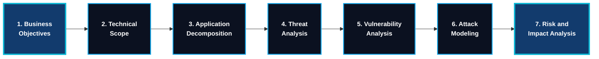
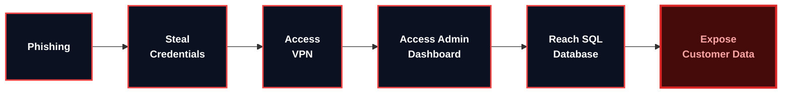
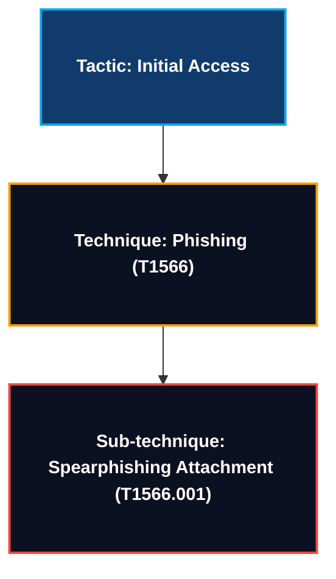

<h1 align="center"> Threat Modeling for Pentesters </h1>


---


### Lab RooM

https://tryhackme.com/room/threatmodelingforpentesters

---


### Table of Contents

- [Task 1: Introduction](#task-1-introduction)
- [Task 2: Four Questions and Three Frameworks](#task-2-four-questions-and-three-frameworks)
- [Task 3: The Building Blocks: Assets, Data Flows, and Trust Boundaries](#task-3-the-buidling-blocks-assets-data-flows-and-trust-boundaries)
- [Task 4: STRIDE: Systematic Threat Identification](#task-4-stride-systematic-threat-identification)
- [Task 5: Scoring Threat With DREAD](#task-5-scoring-threat-with-dread)
- [Task 6: PASTA: Risk-Centric with DREAD](#task-6-pasta-risk-centric-with-dread)
- [Task 7: MITRE ATT&CK for Threat Modeling](#task-7-mitre-attck-for-threat-modeling)
- [Task 8: Putting It All Together: Threat Modelling Stratford Systems](#task-8-putting-it-all-together-threat-modelling-stratford-systems)
- [Task 9: Conclusion](#task-9-conclusion)


---


## Task 1: Introduction

**Threat Modeling** is the process of identifying what needs protection, possible threats, vulnerabilities, and where security testing should focus.

#### Why is it important?

Before scanning a network, a penetration tester needs to understand the client's most important assets.

Example: Stratford Systems
| Asset                | Importance |
| -------------------- | ---------- |
| Payment Portal       | Critical   |
| Customer Database    | Critical   |
| Payment API          | High       |
| Internal File Server | Medium     |
| Print Server         | Low        |

#### Main objectives

1. **Identify assets**: What needs protection?
2. **Identify threats**: What could an attacker do?
3. **Identify weaknesses**: Where could security fail?
4. **Assess risk**: How serious would the impact be?
5. **Prioritize testing**: Which systems should be tested first?


---


### Where Threat Modeling Fits in the Pentest Lifecycle


According to the **[Penetration Testing Execution Standard (PTES)](http://www.pentest-standard.org/)**, penetration testing has seven phases:


According to the Penetration Testing Execution Standard (PTES), penetration testing has seven phases:

| Phase | Name                   | Purpose                                       |
| ----- | ---------------------- | --------------------------------------------- |
| 1     | Pre-Engagement         | Define scope and authorization                |
| 2     | Intelligence Gathering | Collect target information                    |
| 3     | Threat Modeling        | Identify and prioritize important risks       |
| 4     | Vulnerability Analysis | Find security weaknesses                      |
| 5     | Exploitation           | Test whether vulnerabilities can be exploited |
| 6     | Post-Exploitation      | Assess access and potential impact            |
| 7     | Reporting              | Document findings and recommendations         |


---


### Learning Objectives

By the end of this room, we will be able to:
- Explain why threat modeling is a critical pre-engagement activity for penetration testers
- Identify where threat modeling sits in the Penetration Testing Execution Standard (PTES) lifecycle
- Describe the four-question framework that underpins all threat modeling methodologies
- Recognize the three frameworks covered in this room and their complementary roles


---


### Question & Answer:


-----


## Task 2: Four Questions and Three Frameworks


### The Four Questions

Threat modeling answers four important questions to understand and manage security risks.

| Question                             | Simple meaning                                                   |
| ------------------------------------ | ---------------------------------------------------------------- |
| 1. What are we working on?           | Understand the system, assets, components, and data flows.       |
| 2. What can go wrong?                | Identify possible threats and attacks.                           |
| 3. What are we going to do about it? | Decide how to reduce or handle each risk.                        |
| 4. Did we do a good enough job?      | Review the analysis and check that nothing important was missed. |

#### Example: Payment Portal

Imagine testing an online payment system:

1. **Understand**: It has a login page, payment API, and customer database.
2. **Identify threats**: Attackers might steal accounts or access customer data.
3. **Take action**: Recommend MFA, access controls, and secure coding.
4. **Review**: Verify that the risks were properly addressed.

**Threat Modeling Manifesto:** https://www.threatmodelingmanifesto.org/


---


### Three Frameworks, Three Perspectives


All three frameworks answer one question: What can go wrong?

#### 1. STRIDE - Identify Threats

**STRIDE** provides six categories to identify security threats.

- **S** – **Spoofing**: Pretending to be someone else.
- **T** – **Tampering**: Modifying data.
- **R** – **Repudiation**: Denying an action.
- **I** – **Information Disclosure**: Exposing sensitive information.
- **D** – **Denial of Service**: Making a service unavailable.
- **E** – **Elevation of Privilege**: Gaining unauthorized permissions.

DREAD is a scoring model used to prioritize identified threats.

#### 2. PASTA - Business Risk

**PASTA** has seven stages. It starts with business objectives and works toward technical threats.

> Focus security testing on risks that could cause the most business damage.

#### 3. MITRE ATT&CK - Real Attacks

Documents real-world adversary tactics and techniques.

> Understand how actual attackers operate and use that knowledge to plan security testing.

#### Comparison

| Framework    | Main focus                     |
| ------------ | ------------------------------ |
| STRIDE       | Categorize security threats    |
| PASTA        | Understand business risks      |
| MITRE ATT&CK | Study real attacker techniques |

---

### Question & Answer

#### What is the name of the framework that uses six threat categories including Spoofing and Tampering?
````
STRIDE
````


----


## Task 3: The Buidling Blocks: Assets, Data Flows, and Trust Boundaries


### Three Building Blocks of Threat Modeling

| Concept          | Simple meaning                | Example                     |
| ---------------- | ----------------------------- | --------------------------- |
| Assets           | What to protect               | Passwords, customer data    |
| Data Flows       | How data moves                | Customer → API → Database   |
| Trust Boundaries | Where security controls apply | Internet → Internal Network |


## Assets: What Are We Protecting?

An **asset** is anything valuable that an organization needs to protect from attackers.

There are three main types:

#### 1. Data Assets

Information that needs protection.

Examples:

- Customer personal information (PII).
- Credit card numbers.
- Passwords and credentials.
- Transaction records.

#### 2. System Assets

Infrastructure that stores, processes, or transfers data.

Examples:

- Servers.
- Databases.
- APIs.
- Network devices.
- Cloud services.

#### 3. Business Process Assets
Important business activities and workflows.

Examples:

- Payment processing.
- Online banking.
- Customer transactions.
- Financial operations.

> Identify all three asset types before testing so you know what attackers might target and what the organization needs to protect.


---


### Data Flow Diagrams: Mapping the System

A **Data Flow Diagram (DFD)** is a visual diagram that shows how data moves between users, applications, databases, and other systems.

#### Five DFD elements

| Element         | Symbol         | Meaning                          | Example                     |
| --------------- | -------------- | -------------------------------- | --------------------------- |
| External Entity | Rectangle      | Outside user or system           | Customer                    |
| Process         | Circle         | Processes or changes data        | Web Application             |
| Data Store      | Parallel lines | Stores information               | SQL Database                |
| Data Flow       | Arrow          | Shows data movement              | HTTPS Request               |
| Trust Boundary  | Dashed line    | Separates different trust levels | Internet / Internal Network |

> **DFD** = Visual map of a system showing its components, data flows, and trust boundaries.

---


### Building a DFD: The StratPay Portal

This example shows how customer payment information travels through Stratford Systems.

1. **External Entity**: Customer using a web browser.
2. **Trust Boundary 1**: Separates the untrusted Internet from Stratford's DMZ.
3. **Process 1**: StratPay Web Application receives and validates customer requests.
4. **Trust Boundary 2**: Separates the DMZ from the internal network.
5. **Process 2**: Internal API Gateway authenticates and routes API requests.
6. **Data Flows**: Arrows show information moving between components and the database.
7. **Add the Data Store**: The SQL Server Database stores customer information, payment card details, and transaction history.

````mermaid
flowchart TD
    %% Define the nodes with their descriptions
    Customer["<b>Customer (Browser)</b><br>External Entity"]
    WebApp["<b>StratPay Web Application</b><br>Process"]
    APIGateway["<b>Internal API Gateway</b><br>Process"]
    Database[("<b>SQL Server Database</b><br>Data Store – Customer and Payment Records")]

    %% Define the connections with the text on the arrows
    Customer -->|"HTTPS Request – Payment Details"| WebApp
    WebApp -->|"API Call – Transaction Data"| APIGateway
    APIGateway -->|"Database Query"| Database

    %% Define the Trust Boundaries using subgraphs
    subgraph TB1 ["🛡️ Trust Boundary 1: Internet — DMZ"]
        WebApp
    end

    subgraph TB2 ["🛡️ Trust Boundary 2: DMZ — Internal Network"]
        APIGateway
    end

    %% Styling to match the dark theme
    classDef entity fill:#1a1a1a,stroke:#555,stroke-width:2px,color:#fff;
    classDef process fill:#1a1a1a,stroke:#eab308,stroke-width:2px,stroke-dasharray: 5 5,color:#fff;
    classDef datastore fill:#1a1a1a,stroke:#555,stroke-width:2px,color:#fff;
    classDef boundary fill:transparent,stroke:#eab308,stroke-width:2px,stroke-dasharray: 5 5,color:#eab308;

    class Customer entity;
    class WebApp,APIGateway process;
    class Database datastore;
    class TB1,TB2 boundary;
````

---

### Trust Boundaries: Where Vulnerabilities Concentrate

**Trust Boundaries** are points where data moves between different security zones.

Example:
- **Internet → DMZ**: Untrusted customer requests enter the web application.
- **DMZ → Internal Network**: Web application communicates with internal services.
- **Internal Network → Database**: Requests access sensitive information.

#### Why are they important?

Attackers may exploit weak security controls at these boundaries through:
- SQL Injection
- Cross-Site Scripting (XSS)
- Unauthorized access
- Privilege escalation

> Trust boundaries are important testing points because they separate different security levels and control how data enters or moves between systems.

---


### Attack Surface

The **Attack Surface** is the total number of entry points where an attacker could interact with or attack a system.

Examples:
- Login pages.
- API endpoints.
- File upload forms.
- Exposed services.
- Admin dashboards.

> A smaller attack surface means fewer opportunities for attackers and an easier system to protect.

---

### DFD Tools

### DFD Tools

These tools help us create **Data Flow Diagrams (DFDs)** for threat modeling.

| Tool                           | Purpose                                                |
| ------------------------------ | ------------------------------------------------------ |
| OWASP Threat Dragon            | Creates security-focused DFDs and STRIDE threat models |
| Microsoft Threat Modeling Tool | Automatically identifies STRIDE threats from diagrams  |
| Draw\.io                       | Creates diagrams easily                                |
| Excalidraw                     | Draws quick, simple diagrams collaboratively           |

> DFD tools help visualize system components, data flows, and trust boundaries to identify security threats.

---


### Questions & Answers

#### 1. What DFD element is represented by a dashed line?

````
Trust Boundary
````


---


#### 2. Which DFD element type is used to represent application logic that transforms or acts on data?
````
Process
````


-----


## Task 4: STRIDE: Systematic Threat Identification

**STRIDE** is a threat modeling framework that provides a structured checklist of six security threat categories.

It helps penetration testers systematically identify possible threats instead of relying on guesswork.

##### Six STRIDE Categories

| Letter | Threat                 | Meaning                          |
| ------ | ---------------------- | -------------------------------- |
| S      | Spoofing               | Pretending to be someone else    |
| T      | Tampering              | Modifying data                   |
| R      | Repudiation            | Denying an action                |
| I      | Information Disclosure | Exposing sensitive information   |
| D      | Denial of Service      | Making a service unavailable     |
| E      | Elevation of Privilege | Gaining unauthorized permissions |

> STRIDE helps identify security threats consistently by checking every component in a Data Flow Diagram (DFD).


---


### Origins

### STRIDE Origins

- **Created**: ``1999``.
- **Creators**: Loren Kohnfelder and Praerit Garg at Microsoft.
- **Popularized by**: Adam Shostack.
- **Used in**: Microsoft's Security Development Lifecycle (SDL) and Threat Modeling Tool.

> **STRIDE** is a Microsoft-developed framework that provides six categories for systematically identifying security threats.


### The Six Categories

**STRIDE** is a framework for identifying six types of security threats.

| Letter | Threat                 | Meaning                                     | Security property |
| ------ | ---------------------- | ------------------------------------------- | ----------------- |
| S      | Spoofing               | Pretending to be someone else               | Authentication    |
| T      | Tampering              | Modifying data without permission           | Integrity         |
| R      | Repudiation            | Denying an action without reliable evidence | Non-repudiation   |
| I      | Information Disclosure | Exposing sensitive information              | Confidentiality   |
| D      | Denial of Service      | Making a service unavailable                | Availability      |
| E      | Elevation of Privilege | Gaining unauthorized permissions            | Authorization     |


**Note:**
- **S** = Fake identity
- **T** = Change data
- **R** = Deny actions
- **I** = Leak information
- **D** = Disrupt services
- **E** = Gain higher privileges

> **STRIDE** helps penetration testers systematically identify security threats in every component of a system.


---


### The DFD-to-STRIDE Mapping Table

This table shows which STRIDE threats apply to each DFD element.

| DFD Element     | Applicable Threats                                    |
| --------------- | ----------------------------------------------------- |
| External Entity | Spoofing, Repudiation                                 |
| Process         | All six STRIDE threats                                |
| Data Flow       | Tampering, Information Disclosure, DoS                |
| Data Store      | Tampering, Repudiation\*, Information Disclosure, DoS |

1. **Process**: Highest priority because it can face all six threat categories.
2. **Data Store**: Can face threats such as data modification, information leakage, and service disruption.
3. **Repudiation (\*)**: Applies to a data store when it contains audit logs that attackers could alter or delete.

> Use this mapping table as a checklist when applying STRIDE to each component in your Data Flow Diagram.

---

### Two Analysis Approaches

**STRIDE** has two ways to identify threats.

#### 1. STRIDE-per-Element

Analyze every component in the DFD and check all applicable STRIDE categories.
- More detailed and comprehensive.
- Takes more time.
- Best for small or high-security systems.

#### 2. STRIDE-per-Interaction

Focus on data flows crossing trust boundaries.
- Focuses on important communication points.
- Faster and more efficient.
- Useful for penetration testing.


---


### Applied Walkthrough: STRIDE Against the StratPay Web Application

The **StratPay Web Application** is vulnerable to all six STRIDE threat categories.

| Threat                 | Example attack                          | What to test                        |
| ---------------------- | --------------------------------------- | ----------------------------------- |
| Spoofing               | Attacker impersonates a customer        | Authentication and session security |
| Tampering              | Attacker changes payment amounts        | Payment data integrity              |
| Repudiation            | User denies making a transaction        | Audit logs and transaction records  |
| Information Disclosure | Attacker accesses other customers' data | IDOR, SQL Injection, API responses  |
| Denial of Service      | Attacker overwhelms the payment portal  | Resource limits and availability    |
| Elevation of Privilege | Customer gains administrator access     | Access controls and authorization   |


---


### Limitations of STRIDE

**STRIDE** is useful for identifying threats, but it has four main limitations.

| Limitation         | Simple explanation                                          |
| ------------------ | ----------------------------------------------------------- |
| No Prioritization  | Identifies threats but doesn't rank them by risk.           |
| Resource-Intensive | Takes time when analyzing large, complex systems.           |
| Static Analysis    | Focuses on system design, not changing real-world behavior. |
| DFD Dependency     | Inaccurate diagrams can lead to missed threats.             |


---


### Questions & Answers:


#### 1. Which STRIDE category directly violates the security property of integrity?
````
Tampering
````


---

#### 2. During your STRIDE analysis of the StratPay Portal, you discover that the application does not log failed authentication attempts. Which STRIDE category does this logging gap fall under?

````
Repudiation
````


---

#### 3. According to the DFD-to-STRIDE mapping table, which DFD element type is susceptible to all six STRIDE categories?
````
Process 
````


----


## Task 5: Scoring Threat With DREAD

**DREAD** is a risk-scoring model used to prioritize security threats based on how dangerous they are.

It helps penetration testers decide which vulnerabilities to test first.

#### Five DREAD Categories

| Letter | Category         | Meaning                                       |
| ------ | ---------------- | --------------------------------------------- |
| D      | Damage Potential | How much damage can occur?                    |
| R      | Reproducibility  | How easily can the attack be repeated?        |
| E      | Exploitability   | How easy is it to exploit?                    |
| A      | Affected Users   | How many users are impacted?                  |
| D      | Discoverability  | How easy is it to discover the vulnerability? |


### Origins and Deprecation

- **Created**: ``2002`` by Michael Howard and David LeBlanc at Microsoft.
- **Purpose**: Prioritize security threats using numerical risk scores.
- **Discontinued by Microsoft**: Around 2008 because different teams scored the same threats inconsistently.
- **Replacement**: Microsoft moved toward severity labels: Critical, Important, Moderate, and Low.

#### Why is DREAD still important?

It is still used as a simple threat-prioritization learning model and appears in cybersecurity training and certification materials.

> DREAD helps prioritize threats, but its numerical scoring can be subjective and inconsistent.


### The Five Categories

**DREAD** scores each security threat from ``1`` to ``10``. Higher scores mean greater risk.

| Letter | Category         | Simple meaning                            |
| ------ | ---------------- | ----------------------------------------- |
| D      | Damage Potential | How much damage can it cause?             |
| R      | Reproducibility  | How easily can the attack be repeated?    |
| E      | Exploitability   | How easy is it to exploit?                |
| A      | Affected Users   | How many users are impacted?              |
| D      | Discoverability  | How easy is it to find the vulnerability? |

#### Scoring Example

| Score | Risk level |
| ----- | ---------- |
| 1–3   | Low        |
| 4–6   | Medium     |
| 7–10  | High       |

#### Example: Payment Database Compromise

| Category         | Score |
| ---------------- | ----- |
| Damage Potential | 10    |
| Reproducibility  | 9     |
| Exploitability   | 8     |
| Affected Users   | 10    |
| Discoverability  | 7     |
| Total            | 44/50 |

Average score: ``44 % 5 = 8.8/10`` = **High Risk**.

> DREAD helps us measure how dangerous a threat is and decide which threats should be tested first.

---


### The Discoverability Controversy


**Discoverability** measures how easily an attacker can find a vulnerability.

There are two different opinions:
1. **Always score 10**: Vulnerabilities can become public anytime, so hiding them is not reliable security.
2. **Score based on difficulty**: Some vulnerabilities are genuinely harder to discover than others.

#### DREAD-D

**OpenStack** introduced a modified model called DREAD-D, which removes Discoverability and uses only four categories.

| Category         | Included? |
| ---------------- | --------- |
| Damage Potential | Yes       |
| Reproducibility  | Yes       |
| Exploitability   | Yes       |
| Affected Users   | Yes       |
| Discoverability  | No        |

> There is no universally correct approach. Choose one scoring method, document it, and apply it consistently.


---


### Calculating the Risk Score

**DREAD calculates** the average score of five threat categories.

#### Severity levels

| Average Score | Severity |
| ------------- | -------- |
| 9.0–10.0      | Critical |
| 7.0–8.9       | High     |
| 4.0–6.9       | Medium   |
| 1.0–3.9       | Low      |

#### Example
Suppose a threat receives these scores:

| Category        | Score |
| --------------- | ----- |
| Damage          | 10    |
| Reproducibility | 9     |
| Exploitability  | 8     |
| Affected Users  | 10    |
| Discoverability | 7     |
| Total           | 44    |

Calculation: `44 % 5 = 8.8` = ``High Risk – 8.8/10``

> Calculate the average of all five scores to determine the threat's severity and testing priority.

---


### Worked Example 1: SQL Injection in the Payment Search Feature

This example shows how to use DREAD to calculate the risk of an SQL Injection vulnerability.

#### DREAD Scoring

| Category        | Score | Reason                                    |
| --------------- | ----- | ----------------------------------------- |
| Damage          | 9     | Could expose customer and payment data.   |
| Reproducibility | 8     | Attack can be repeated reliably.          |
| Exploitability  | 7     | Available tools make exploitation easier. |
| Affected Users  | 9     | Many customers could be affected.         |
| Discoverability | 8     | Public search feature is easy to find.    |
| Total           | 41    |                                           |


**Risk Calculation**: ``(9 + 8 + 7 + 9 + 8) / 5 = 8.2`` = ``High Risk – 8.2/10``

> SQL Injection receives a high-risk rating because it could expose sensitive customer information and affect many users. It should be prioritized for penetration testing.


---


### Worked Example 2: Verbose Error Messages on the Admin Dashboard

The admin dashboard exposes sensitive technical information, such as stack traces and database connection strings.

#### DREAD Scoring

| Category        | Score | Reason                                               |
| --------------- | ----- | ---------------------------------------------------- |
| Damage          | 3     | Information exposure, but no direct data compromise. |
| Reproducibility | 10    | Easy to trigger every time.                          |
| Exploitability  | 9     | Requires little technical skill.                     |
| Affected Users  | 2     | Only administrators are affected.                    |
| Discoverability | 6     | Requires VPN and admin access.                       |
| Total           | 30    |                                                      |

**Risk Calculation**: `(3 + 10 + 9 + 2 + 6) / 5` =  ``Medium Risk – 6.0/10``


**Why is it Medium?**

Although the vulnerability is easy to trigger and exploit, its direct damage and affected-user scores are low.

> High exploitability does not always mean high overall risk. DREAD considers all five categories before determining severity.

---


### DREAD vs. CVSS: A Brief Comparison

Both are used to assess security risks, but they serve different purposes.

| Feature        | DREAD                   | CVSS                           |
| -------------- | ----------------------- | ------------------------------ |
| Purpose        | Prioritize threats      | Measure vulnerability severity |
| Complexity     | Simple                  | More complex                   |
| Scoring        | Average of 5 categories | Multiple scoring metrics       |
| Best use       | Quick threat assessment | Formal vulnerability reporting |
| Main advantage | Fast and easy           | More standardized              |


---


### Questions & Answers

#### 1. What does the "A" in DREAD stand for?

````
Affected Users
````


---

#### 2. You are scoring a Denial of Service vulnerability in the StratPay Portal. The vulnerability can be triggered by anyone on the Internet, requires no authentication, and crashes the entire payment portal affecting all customers. However, it causes no data loss, and the system recovers automatically on restart. Which DREAD category would receive the lowest score?

````
Damage
````


-----


## Task 6: PASTA: Risk-Centric with DREAD


## Introduction to PASTA

**PASTA (Process for Attack Simulation and Threat Analysis)** is a threat modeling framework that focuses on business risks and their impact.

Unlike STRIDE, PASTA starts with business objectives and works toward technical threats.

> PASTA helps penetration testers focus on threats that could cause the greatest damage to the business, not just technical vulnerabilities.


---

### Origins

- **Full name**: Process for Attack Simulation and Threat Analysis.
- **Creator**: Tony UcedaVélez.
- **First presented**: 2012 at OWASP AppSecEU.
- **Reference book**: Risk Centric Threat Modeling (2015).
- **Purpose**: Connect business risks with technical security threats.

> **PASTA** starts with business objectives, analyzes technical threats, and produces risk-based security priorities.


---


### The Seven Stages

**PASTA (Process for Attack Simulation and Threat Analysis)** is a seven-stage threat modeling methodology that connects business risks with technical security threats.

| Stage | Name                      | Simple meaning                                                    |
| ----- | ------------------------- | ----------------------------------------------------------------- |
| 1     | Define Objectives         | Understand business goals and what needs protection.              |
| 2     | Define Technical Scope    | Identify systems, servers, applications, and technologies.        |
| 3     | Application Decomposition | Map data flows, components, and trust boundaries (DFD).           |
| 4     | Threat Analysis           | Identify realistic threats using threat intelligence.             |
| 5     | Vulnerability Analysis    | Find weaknesses in the systems.                                   |
| 6     | Attack Modeling           | Build attack paths showing how attackers could reach their goals. |
| 7     | Risk and Impact Analysis  | Evaluate the business damage if attacks succeed.                  |

#### Example: Stratford Systems



#### Important example

An attacker steals an employee's credentials:



> **PASTA** helps penetration testers understand business priorities, identify realistic attack paths, and determine the potential impact of an attack.

---


### STRIDE vs. PASTA: Choosing the Right Tool

Both frameworks identify security risks, but they approach the problem differently.

| Dimension      | STRIDE                    | PASTA                              |
| -------------- | ------------------------- | ---------------------------------- |
| Main focus     | Identify threats          | Analyze business risks             |
| Starting point | System architecture (DFD) | Business objectives                |
| Perspective    | System / defender         | Attacker / business                |
| Output         | List of threats           | Prioritized risks and attack paths |
| Time required  | Moderate                  | More time-consuming                |
| Best for       | Threat identification     | Risk-driven penetration testing    |


---

### Questions & Answers:


#### 1. After completing your threat model, the client asks your pentest team to justify why you are prioritizing the payment portal over the internal company wiki. Which PASTA stage provides the business-risk evidence to support this prioritization?
````
Stage 7
````


---

#### 2. During a PASTA analysis for Stratford Systems, your team discovers that financial sector threat intelligence reports show a 300% increase in API-targeted attacks over the past year. In which PASTA stage would you incorporate this finding?

````
Stage 4
````


-----


## Task 7: MITRE ATT&CK for Threat Modeling

[MITRE ATT&CK](https://attack.mitre.org/) is a cybersecurity knowledge base that documents real-world attacker tactics and techniques based on observed attacks.

It helps penetration testers understand how real attackers operate.


### What Is MITRE ATT&CK?

**MITRE ATT&CK** is a knowledge base of real-world attacker behaviors used by cybersecurity professionals to understand and analyze attacks.

ATT&CK stands for Adversarial Tactics, Techniques, and Common Knowledge.

#### Three Important Concepts

| Concept       | Meaning                                   | Example                  |
| ------------- | ----------------------------------------- | ------------------------ |
| Tactic        | Why an attacker performs an action (goal) | Initial Access           |
| Technique     | How an attacker achieves the goal         | Phishing                 |
| Sub-technique | A more specific attack method             | Spearphishing Attachment |

#### Example



---


### The 14 Enterprise Tactics

A Tactic describes the attacker's goal or why they perform an action.

| #  | Tactic               | Simple meaning                       |
| -- | -------------------- | ------------------------------------ |
| 1  | Reconnaissance       | Gather target information            |
| 2  | Resource Development | Prepare tools and infrastructure     |
| 3  | Initial Access       | Enter the target system              |
| 4  | Execution            | Run malicious code                   |
| 5  | Persistence          | Maintain access                      |
| 6  | Privilege Escalation | Gain higher permissions              |
| 7  | Defense Evasion      | Avoid security detection             |
| 8  | Credential Access    | Steal passwords and credentials      |
| 9  | Discovery            | Explore the target environment       |
| 10 | Lateral Movement     | Move to other systems                |
| 11 | Collection           | Gather valuable data                 |
| 12 | Command and Control  | Communicate with compromised systems |
| 13 | Exfiltration         | Transfer stolen data out             |
| 14 | Impact               | Damage or disrupt systems            |

#### Simple Attack Flow

```mermaid
flowchart LR
    %% Define Nodes
    N1["<b>1. Recon</b>"]
    N2["<b>2. Resource<br>Dev</b>"]
    N3["<b>3. Initial<br>Access</b>"]
    N4["<b>4. Execution</b>"]
    N5["<b>5. Persistence</b>"]
    N6["<b>6. Priv<br>Escalation</b>"]
    N7["<b>7. Defense<br>Evasion</b>"]
    N8["<b>8. Credential<br>Access</b>"]
    N9["<b>9. Discovery</b>"]
    N10["<b>10. Lateral<br>Movement</b>"]
    N11["<b>11. Collection</b>"]
    N12["<b>12. Command<br>& Control</b>"]
    N13["<b>13. Exfiltration</b>"]
    N14["<b>14. Impact</b>"]

    %% Connections (Left to Right)
    N1 --> N2 --> N3 --> N4 --> N5 --> N6 --> N7 --> N8 --> N9 --> N10 --> N11 --> N12 --> N13 --> N14

    %% Cyber Styling
    classDef default fill:#0B1120,stroke:#0EA5E9,stroke-width:2px,color:#FFFFFF,font-size:13px,padding:10px;
    
    %% Highlight Start and End
    classDef startNode fill:#123B6D,stroke:#06B6D4,stroke-width:3px,color:#FFFFFF;
    classDef endNode fill:#450a0a,stroke:#DC2626,stroke-width:3px,color:#FCA5A5;
    
    class N1 startNode;
    class N14 endNode;
```



> **Note**: This is a simplified learning sequence. Real attacks don't always follow this exact order.

> MITRE ATT&CK provides 14 Enterprise tactics to help security professionals understand and analyze attacker objectives.


---


### Connecting ATT&CK to the Cyber Kill Chain

Both frameworks explain how cyberattacks happen, but at different levels of detail.

#### Comparison

| Cyber Kill Chain      | MITRE ATT&CK Tactic              |
| --------------------- | -------------------------------- |
| Reconnaissance        | Reconnaissance                   |
| Weaponization         | Resource Development             |
| Delivery              | Initial Access                   |
| Exploitation          | Execution                        |
| Installation          | Persistence                      |
| Command and Control   | Command and Control              |
| Actions on Objectives | Collection, Exfiltration, Impact |

#### Main Difference

The Cyber Kill Chain provides 7 high-level attack phases, while MITRE ATT&CK provides 14 detailed Enterprise tactics.

Five ATT&CK tactics have no direct Kill Chain equivalent:
1. Privilege Escalation
2. Defense Evasion
3. Credential Access
4. Discovery
5. Lateral Movement


----


### Threat Modeling with ATT&CK: The CTID Methodology


#### MITRE ATT&CK - CTID Methodology

The **CTID (Center for Threat-Informed Defense)** methodology uses real-world threat intelligence to identify which attacks are most relevant to an organization.

#### Main concept: Theory vs. Evidence
- An attacker could exploit a vulnerability.

> Evidence: Real attackers have been observed using that technique against similar organizations.

> Evidence-based threats receive higher priority.

#### Five Steps

| Step | Activity                 | Purpose                                           |
| ---- | ------------------------ | ------------------------------------------------- |
| 1    | Search by Industry       | Identify attackers targeting your industry.       |
| 2    | Search by Platform       | Identify techniques targeting your technologies.  |
| 3    | Compile Navigator Layers | Create ATT&CK layers for relevant threats.        |
| 4    | Overlay and Analyze      | Find techniques appearing across multiple layers. |
| 5    | Map Defenses to Gaps     | Identify missing security controls.               |

#### Example: Stratford Systems

Stratford is a financial services company using Windows Server and SQL Server.

- Industry threats: FIN7 and FIN8.
- Technology: Windows Server and SQL Server.
- Identify overlapping attacker techniques.
- Check whether Stratford can detect and prevent those techniques.
- Prioritize testing where security gaps exist.


---


### Applied Walkthrough: ATT&CK Against Stratford Systems

This example uses MITRE ATT&CK to identify attacks that are relevant to Stratford's financial services environment.

#### Industry Search

Identify techniques used by attackers targeting financial organizations.

| Technique                                 | Meaning                                       |
| ----------------------------------------- | --------------------------------------------- |
| ``T1566 - Phishing``                          | Trick employees into opening malicious emails |
| ``T1059 - Command and Scripting Interpreter`` | Execute commands using PowerShell or scripts  |
| ``T1078 - Valid Accounts``                    | Use stolen legitimate credentials             |

#### Platform Search

Identify attacks targeting Stratford's technologies.

| Technique | Meaning                                    |
| --------- | ------------------------------------------ |
| ``T1190``     | Exploit public-facing applications         |
| ``T1133``     | Abuse external remote services such as VPN |
| ``T1505.001`` | Abuse SQL stored procedures                |

#### Combined Analysis

``T1078`` (Valid Accounts) appears in both industry and platform analysis.

> This makes credential-based attacks a high priority for Stratford.

---


### Key Tools


## Key MITRE ATT&CK Tools

These three tools help security professionals perform ATT&CK-based threat modeling.

| Tool             | Purpose                                                        |
| ---------------- | -------------------------------------------------------------- |
| [ATT&CK Navigator](https://mitre-attack.github.io/attack-navigator/) | Visualize, score, color-code, and compare attack techniques.   |
| [CISA Decider](https://github.com/cisagov/Decider/)     | Identify the correct ATT&CK techniques using guided questions. |
| [Atomic Red Team](https://github.com/redcanaryco/atomic-red-team)  | Provides small security tests mapped to ATT&CK techniques.     |


---


### Questions & Answers:


#### 1. How many tactics are in the MITRE ATT&CK Enterprise matrix (v18)?

Go to: https://attack.mitre.org/resources/updates/updates-october-2025/?utm_source=chatgpt.com#statistics


Now we see tactic is:
````
14
````


---


#### 2. What is the first ATT&CK tactic (alphabetically) that has no direct equivalent in the Cyber Kill Chain?

````
Credential Access
````


-----


## Task 8: Putting It All Together: Threat Modelling Stratford Systems

We will combine everything learned to create a complete threat model that guides the penetration test.

| Topic        | What you do                                   |
| ------------ | --------------------------------------------- |
| DFD          | Map systems, data flows, and trust boundaries |
| STRIDE       | Identify security threats                     |
| DREAD        | Score and prioritize threats                  |
| PASTA        | Connect threats to business risks             |
| MITRE ATT&CK | Identify real-world attacker techniques       |

> Create a prioritized penetration-testing plan that focuses on Stratford Systems' most critical risks.


### The Engagement Briefing

- **Industry**: Financial services.
- **Main assets**: Payment portal, customer database, employee credentials.
- **Engagement**: 10 business days.
- **Authorization**: External testing, limited VPN internal access, no bulk database extraction, phishing simulation for 5 approved employees.

**Main CISO concern**: Can stolen employee credentials lead to unauthorized access to the payment database?

> Test the attack path from employee credentials → VPN → Active Directory → Admin Dashboard → SQL Server.

---


### Guided Exercise: Five Steps to a Threat Model

Click on **View Site** to start lab:


#### Step 1: Review the DFD (Task 2: Building Blocks)

### Step 1: Review the Stratford Systems DFD

We need to inspect 5 Trust Boundaries (TBs) in the diagram.

| Boundary | Separates                        |
| -------- | -------------------------------- |
| TB1      | Internet ↔ DMZ                   |
| TB2      | DMZ ↔ Internal Network           |
| TB3      | Internal Network ↔ Database Zone |
| TB4      | Internet ↔ VPN Tunnel            |
| TB5      | VPN Tunnel ↔ Internal Network    |


Click on weach of it then click `inspect`:


---


### Step 2: Apply STRIDE (Task 3: Threat Identification)


Select these categories for each component:

| Component                     | Correct STRIDE Category | Reason                                                                                           |
| ----------------------------- | ----------------------- | ------------------------------------------------------------------------------------------------ |
| A. VPN Authentication Service | Spoofing                | Attacker uses stolen employee credentials to impersonate a legitimate employee.                  |
| B. API Gateway → SQL Server   | Information Disclosure  | Sensitive payment and customer information could be exposed during data transfer.                |
| C. Admin Dashboard            | Elevation of Privilege  | An unauthorized user could gain administrative permissions and issue refunds or manage accounts. |
| D. Audit Log Data Store       | Repudiation             | Attackers could delete or modify audit logs to hide their actions.                               |


---


### Step 3: Score with DREAD (Task 4: Prioritization)


Rank the threats from highest risk to lowest risk.

### Recommended ranking

| Rank | Threat                         | Reason                                                                      |
| ---- | ------------------------------ | --------------------------------------------------------------------------- |
| 1    | Threat 1 – Default Credentials | `admin/admin` could allow unauthorized control of the internal API Gateway. |
| 2    | Threat 2 – SQL Injection       | Could expose all customer payment records.                                  |
| 3    | Threat 4 – Stored XSS          | Malicious JavaScript could execute in other customers' browsers.            |
| 4    | Threat 3 – Verbose Errors      | Exposes technical information but has more limited direct impact.           |

Highest priority: Threat 1


---


### Step 4: Layer ATT&CK Intelligence (Task 6: Adversary Techniques)


Select these three tactics from the dropdown menus:

| Attack Step                                    | Correct Tactic    | Technique |
| ---------------------------------------------- | ----------------- | --------- |
| 1. Phishing email                              | Initial Access    | T1566.001 |
| 2. Harvest credentials                         | Credential Access | T1078     |
| 3. Authenticate to VPN                         | Initial Access    | T1133     |
| 4. Access admin dashboard and pivot internally | Lateral Movement  | T1021     |
| 5. Extract payment data                        | Exfiltration      | T1041     |


---


### Step 5: Prioritize the Test Plan

Rank the objectives from highest priority to lowest priority:

| Rank | Objective                         | Reason                                                                            |
| ---- | --------------------------------- | --------------------------------------------------------------------------------- |
| 1    | B – VPN Credentials & MFA         | Tests the CISO's primary concern: stolen employee credentials gaining VPN access. |
| 2    | C – Admin Dashboard to SQL Server | Tests whether an attacker can pivot internally and reach payment data.            |
| 3    | A – SQL Injection                 | Could expose sensitive customer payment records.                                  |
| 4    | D – Role-Based Access Control     | Tests whether ordinary employees can perform privileged actions.                  |


Now we completed all.

Also got flag:
````
THM{Thr347-Modeling}
````

---


### Questions & Answers:

#### 1. In the DREAD scoring exercise (Step 3), which of the two threats received the higher risk rating: the phished VPN credentials or the SQL injection in the transaction search feature?

On step 3 above  the two threats received the higher risk rating: the phished VPN credentials or the SQL injection in the transaction search feature is:
````
SQL Injection
````


---


#### 2. In the ATT&CK mapping exercise (Step 4), which tactic did you assign to the step where the attacker uses stolen VPN credentials to access the internal network?

On step 4 above tactic did you assign to the step where the attacker uses stolen VPN credentials to access the internal network is:
````
Initial Access
````


---


#### 3. What flag did you get after going through all the steps?
In above we found the flag is:
````
THM{Thr347-Modeling}
````


-----


## Task 9: Conclusion

We used four frameworks to build the Stratford Systems threat model.

| Framework    | Main Question                      | Purpose                           |
| ------------ | ---------------------------------- | --------------------------------- |
| STRIDE       | What can go wrong?                 | Identify threats                  |
| DREAD        | How bad is it?                     | Score and prioritize threats      |
| PASTA        | What does the business care about? | Connect threats to business risks |
| MITRE ATT&CK | What do real attackers do?         | Identify real attack techniques   |

#### Threat Model Lifecycle

A threat model is a living document that changes throughout an engagement.

1. **Before testing**: Define scope, priorities, and attack paths.
2. **During testing**: Validate threats and discover new risks.
3. **After testing**: Update findings and support remediation and retesting.


---

### Question & Answer:


--------


### Now we completed the Lab:


---------
